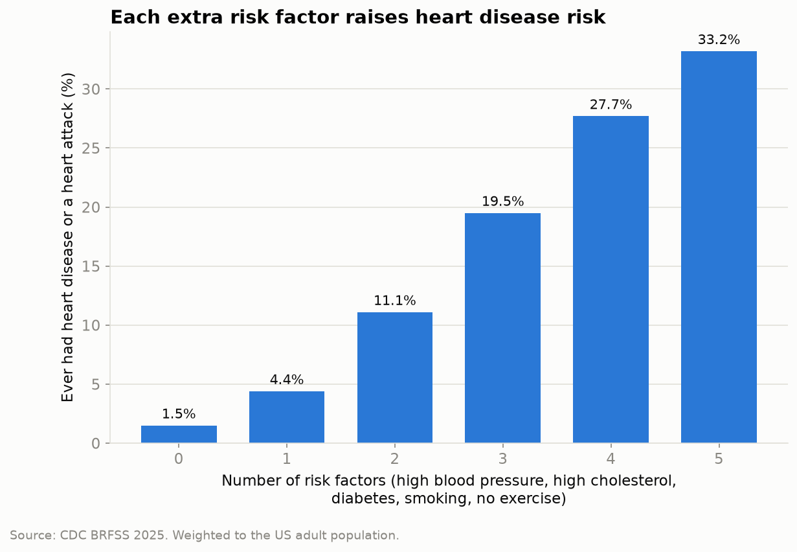
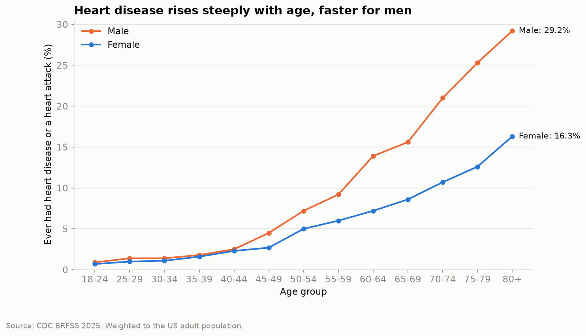
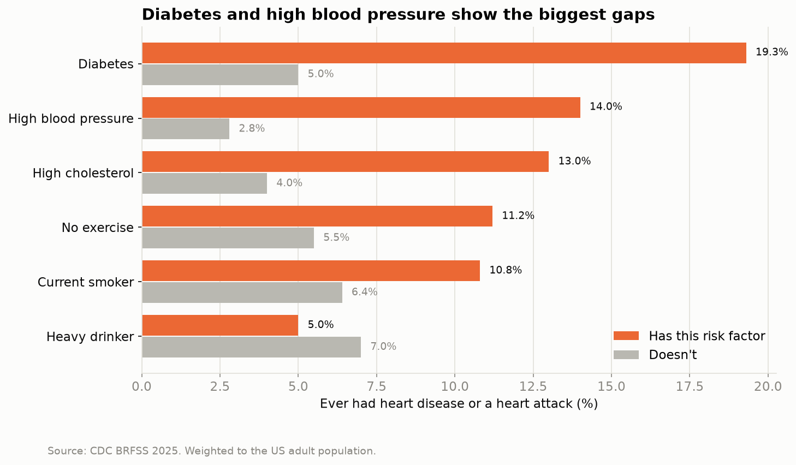
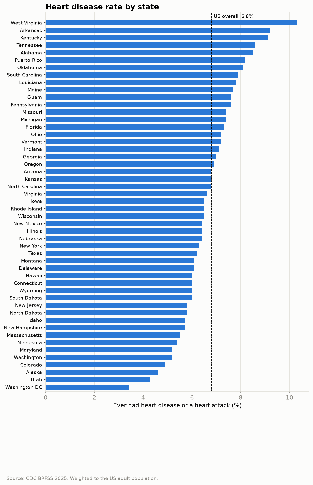
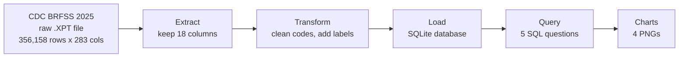

# Heart Health Pipeline

An end-to-end data pipeline in **Python** and **SQL** that turns the CDC's 2025 health survey of **356,158 US adults** into clear answers about who has heart disease, and which risk factors go with it.

**Headline finding:** 1.5% of adults with none of five common risk factors have had heart disease or a heart attack. For people with all five, it's **33.2%**, more than 20 times higher.



---

## Key findings

All rates are **weighted** to represent the US adult population (see [Survey weights](#survey-weights)).

**6.8% of US adults** have ever been told they had coronary heart disease or a heart attack.

### 1. Age is the biggest factor, and men are hit harder

Heart disease rises from under 1% at ages 18–24 to **29.2% in men** and **16.3% in women** aged 80+. The gap between men and women is small until the 40s. From age 60 onwards, men's rate is roughly double women's.



### 2. Diabetes and high blood pressure show the biggest gaps

| Risk factor | With it | Without it |
|---|---|---|
| Diabetes | 19.3% | 5.0% |
| High blood pressure | 14.0% | 2.8% |
| High cholesterol | 13.0% | 4.0% |
| No exercise in past 30 days | 11.2% | 5.5% |
| Current smoker | 10.8% | 6.4% |
| Heavy drinker | 5.0% | 7.0% |



**Heavy drinkers show a *lower* rate.** That doesn't mean drinking protects the heart. Heavy drinkers in the survey tend to be younger, and age is the strongest factor. People who already have heart disease are also often advised to stop drinking, so they appear in the "not a heavy drinker" group. It's a reminder that correlation isn't causation.

### 3. Rates vary threefold between states

West Virginia (10.3%), Arkansas (9.2%) and Kentucky (9.1%) have the highest rates. Washington DC (3.4%), Utah (4.3%) and Alaska (4.6%) have the lowest.

<details>
<summary>See all states</summary>



</details>

---

## How the pipeline works



| Step | File | What it does |
|---|---|---|
| Extract | `src/extract.py` | Reads the 1 GB raw file **in chunks of 50,000 rows**, keeping only the 18 columns needed, so it runs on an ordinary laptop. |
| Transform | `src/transform.py` | Turns survey codes into clean data: "don't know" and "refused" become blanks, yes/no becomes 1/0, codes become readable labels (`_AGEG5YR = 13` becomes `"80+"`), BMI gets its decimal point back. |
| Load | `src/load.py` | Saves the clean table to a SQLite database and checks the row count matches. |
| Query | `sql/queries.sql`, `src/query.py` | Five named SQL queries, each answering one question with **weighted** rates. |
| Charts | `src/charts.py` | Runs the queries and saves the charts with matplotlib, using a colour-blind-safe palette. |
| Run | `run_pipeline.py` | Runs every step in order with one command, timing each one. |

The full pipeline runs in about **17 seconds**.

---

## How to run it

**1. Clone the repo and install the libraries**

```bash
git clone https://github.com/omathestudio/heart-health-pipeline.git
cd heart-health-pipeline
pip install -r requirements.txt
```

**2. Download the data.** The data isn't stored in this repo because it's large (about 1 GB unzipped) and publicly available.

- Go to the [CDC 2025 BRFSS data page](https://www.cdc.gov/brfss/annual_data/annual_2025.html).
- Download **2025 BRFSS Data (SAS Transport Format)**.
- Unzip it into a `data/` folder in the project root, so you have `data/LLCP2025.XPT`.

**3. Run the pipeline**

```bash
python run_pipeline.py
```

On Windows, use `py` instead of `python`. The charts are saved to `charts/` and the database to `data/heart.db`.

---

## Project structure

```
heart-health-pipeline/
├── run_pipeline.py      # runs every step with one command
├── requirements.txt     # Python libraries needed
├── src/
│   ├── extract.py       # read the raw file
│   ├── transform.py     # clean and label the data
│   ├── load.py          # save to SQLite
│   ├── query.py         # run the named SQL queries
│   └── charts.py        # make the charts
├── sql/
│   └── queries.sql      # the analysis questions
├── charts/              # output charts (PNG)
└── data/                # raw data and database (not in GitHub)
```

---

## Decisions and why

- **Raw CDC data rather than a pre-cleaned Kaggle dataset.** The popular Kaggle version is from 2015 and already cleaned. Starting from the newest raw file means building every step myself.
- **The `.XPT` format rather than ASCII.** The XPT file stores its own column positions, so pandas reads it directly. The ASCII file is fixed-width and would need every column's position mapping by hand.
- **Reading in chunks.** The full file has 283 columns. Reading 50,000 rows at a time and keeping only 18 columns keeps memory use low.
- **CDC's calculated variables** (those starting with `_`, like `_MICHD`) where available, because CDC has already combined and checked the underlying questions.
- **Diabetes coded as yes only for a diagnosis of diabetes.** "Only during pregnancy" and "pre-diabetes" count as no.
- **SQL kept in its own file**, separate from the Python, with each query labelled by name.
- **Validated against the official codebook.** Every value code was checked against the 2025 BRFSS codebook, and the number of blanks for each column matches the codebook's "don't know / refused / missing" counts exactly.

### Survey weights

BRFSS reaches some groups of people more easily than others. Each respondent has a weight (`_LLCPWT`) showing how many US adults they represent. Every rate in this project is calculated as:

```
SUM(heart_disease × weight) / SUM(weight)
```

so the results describe the US adult population, not just the people who answered.

---

## Limitations

- **Self-reported.** People report whether a doctor ever told them they had a condition. Undiagnosed cases aren't counted.
- **Not adjusted for age.** The risk-factor comparisons are simple with/without rates. Because age drives both heart disease and many risk factors, some gaps are partly age effects.
- **Correlation, not causation.** This is a single survey at one point in time, so it shows what goes together, not what causes what.
- **Missing answers.** About 1 in 5 people didn't give their income. High cholesterol is blank for people who have never had it checked. Rates are calculated among people who answered each question.
- **Coverage.** California, Mississippi and Nevada aren't in the 2025 results. Puerto Rico and Guam are included.
- **One year only** (2025).

---

## What I'd do next

- **Age-adjusted rates**, so risk-factor comparisons aren't skewed by age.
- **A predictive model**, such as logistic regression, estimating heart disease risk from the risk factors.
- **Multiple years** of BRFSS, to see trends over time.
- **Automated tests** for each pipeline step.

---

## Tools

Python · pandas · SQLite · SQL · matplotlib · Git

## About

Built by **Nneoma (Oma)**: BSc Medical Physiology graduate, starting an MSc in Computing in January 2027, with a focus on data and AI in health.

**Data source:** Centers for Disease Control and Prevention (CDC). Behavioral Risk Factor Surveillance System Survey Data, 2025. Atlanta, Georgia: U.S. Department of Health and Human Services, Centers for Disease Control and Prevention.
